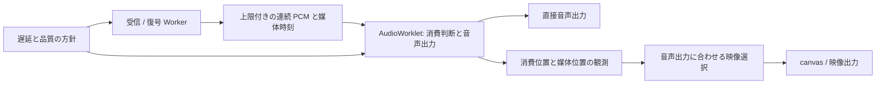

# 超低遅延 A/V 再生の設計レビュー

調査日: 2026-11-08

更新日: 2026-11-09

**現在の方針は第 15 節を参照すること。** 第 1〜14 節は実装時の判断と測定の記録である。
高レベル API は MediaStream を既定とし、直接出力も選択できる。直接出力の測定値は
MediaStream → video 要素での性能を示していない。

対象: `2ed4635bc45be27aca19d4c2a794ffa308afa408` の `src/playout/` と、SDK / DevTools の出力経路。
第 1〜10 節は上記 commit を基準にした評価と設計案である。
その後、再現できた不具合の修正まで進めた。初回の修正内容と検証結果は第 12 節、その後の破壊的な再設計は第 13 節、低遅延と同期精度の同時改善は第 14 節に記載する。
Worker を含む全体構成への移行は実装していない。

## 結論

現行の連続 PCM 出力、出力側の欠落補間、実適用量を予約へ戻す処理は残す価値がある。
一方、超低遅延のリアルタイム音声ライブラリを目指すには、**実際の音声出力位置を基準に、
再生期限と保持量を制限する構造**へ変更する必要がある。

優先する順序は、実予約の上限、出力経路と時計の観測、フレーム長に依存しない音声制御、
適応遅延、欠落時の品質である。50 ms の下限を先に下げると、既存のメインスレッド依存と
短フレームの制約を音切れとして表面化させる可能性がある。

「届いた音をできるだけ保存する」という現在の方針には、リアルタイム用途として限界がある。
遅延の上限と連続性が衝突したときは、古い音を捨て、接続を整えてライブへ戻る明示的な方針が必要である。

## 1. 最初に定義する品質

遅延、同期、音質、負荷を独立に評価する。

| 指標           | 測定する区間 / 内容                                      |
| -------------- | -------------------------------------------------------- |
| 総遅延         | 送信側の収録から受信側の音響 / 映像出力まで              |
| 受信後遅延     | Object の到着から出力まで。復号前の保持も含む            |
| 再生処理の遅延 | 復号済み PCM の到着から出力まで                          |
| A/V 誤差       | 同一の収録時刻に対応する音と映像の出力時刻の差           |
| 音質           | 有声、子音、無音、音楽、ステレオに対する歪みと欠落の影響 |
| リアルタイム性 | 描画量子内の処理時間、締切超過、保持量、負荷後の復帰時間 |

送受信時計の同期が確認できなければ、TIMESTAMP と受信側時計の差を絶対的な総遅延とは呼べない。
同じ時計領域にある音声と映像の相対同期は、それとは分けて評価できる。
Bluetooth など出力機器の遅延も、ソフトウェアだけで消せる待ちとは区別する。

低遅延化の評価は、同じ入力、同じ出力経路、同程度の欠落率で比較する。
補間量の増加や常時の時間圧縮を許して得た遅延短縮は、音質の改善とは別の成果である。

## 2. 現在の構成と残す部分

```text
復号結果
  → AudioPlayoutSession
      → PlayoutTimeline / AudioClockBridge
      → AudioPlayoutScheduler
      → フレーム単位の時間圧縮 / 伸長
      → MessagePort に PCM と予約位置を転送
  → AudioRenderQueue
      → レート変換
  → AudioRenderConcealer
      → 実音 / 欠落補間 / 復帰の接続
  → 出力先

映像復号結果
  → 同じ PlayoutTimeline
  → PlayoutBuffer
  → requestAnimationFrame ごとの選択
  → canvas または MediaStreamTrackGenerator
```

残すべき性質は次のとおりである。

- PCM と予約範囲を同じメッセージで渡し、実音と欠落判定の不一致を避ける
- 連続フレームの境界でサンプルを共有し、端数位置に穴を作らない
- 未着を AudioWorklet 側で検出し、メインスレッド停止中も補間を出す
- 圧縮 / 伸長の要求量ではなく、適用できた量を制御へ戻す
- 音声と映像の共有入口、AudioData / VideoFrame の所有権、停止時の drain を明示する
- 単体テスト、PBT、実 AudioContext / OfflineAudioContext の検証を組み合わせる

全体を一度に書き直す理由はない。これらの性質を維持しながら、制御の責任と時計の扱いを変える。

## 3. 確認した問題

### 3.1. 最優先: 遅着した音の実予約量に上限が効かない

`audioPlayout.ts` の `AudioPlayoutScheduler.schedule()` は、TIMESTAMP 基準の経路で
`targetStartSeconds > nowSeconds + limit` を検査する。しかし、実際の予約開始は
`previousEnd` の後ろへ移動する。目標が過去にある場合、移動後の予約終端をこの上限で制限していない。

実クラスへ次の値を渡して再現した。

- 現在の出力時計は 20 秒
- 音声は 10 ms × 1,000 フレームで、TIMESTAMP は単調増加
- 目標開始は 10 秒から 19.99 秒、到着はすべて 20 秒
- 予算は 50 ms、時間圧縮の適用量は 0

結果は **1,000 フレームを受理し、予約終端が現在より約 10.05 秒先**になった。
これは予約クラスの再現であり、実リレーで毎回この状態になるという測定ではない。
上位の追いつき処理は復号器の再作成を要求できるが、予約済みの PCM の上限を保証する代わりにはならない。
`AudioRenderQueue.enqueue()` 自体にも時間 / バイト数の上限はない。

設計上は、目標時刻、実際の未消費 PCM、媒体の古さをそれぞれ制限する必要がある。
圧縮できない音でも保持量の上限を守り、期限を超えた媒体を明示的に破棄してライブへ戻す。
既に出力デバイスへ渡した音は取り消せないため、再生済み位置と変更可能な位置を区別する。

### 3.2. 高優先: 時計の代用から実時計へ移っても誤差を保持する

`AudioClockBridge.update()` には 30 ms の不感帯がある。
currentTime による代用で offset を 0 とした後、有効な出力時計が offset = -20 ms を示しても、
不感帯内なので offset を更新しない。一方、`usingFallback` は false に変わる。

20 ms ごとの有効な観測を 500 回渡した再現では、10 秒後も 20 ms の誤差が残った。
通常の開始では `prepareAudio()` が有効な時計を待つため、必ず発生するわけではない。
ただし、停止 / 再開や出力時計が一時的に取得できない場合の経路として残る。

さらに、通常の有効な観測間でも 30 ms 未満の変化を保持する設計なので、
タイムラインの同期不感帯が 5 ms であることは、実出力の同期精度が 5 ms であることを意味しない。

代用から有効な時計への初回遷移は、異なる測定方法の切り替えとして対応を取り直す。
継続的な観測では、観測ノイズの推定と実際の再生速度の変更を別の制御にする。
映像同期の制御に使う不感帯を、時計の推定器へそのまま移す設計は改める。

### 3.3. 高優先: 5 / 10 ms フレームで時間伸縮が働かない条件がある

`compressSamples()` は渡されたフレーム内で周期を解析する。
4 kHz へ変換した解析窓には少なくとも 61 サンプルが必要であり、5 / 10 ms では足りない。
`preemptivelyExpandSamples()` も、非無音では直前の最大 10 ms と今回のフレームで
30 ms 以上を要求する。呼び出し側が保持するのは直前の 1 フレームである。

48 kHz、200 Hz、振幅 0.2 の連続波形を実関数へ渡した結果は次のとおりだった。

| フレーム長 |  圧縮の適用量 |  伸長の適用量 |
| ---------- | ------------: | ------------: |
| 5 ms       |    0 サンプル |    0 サンプル |
| 10 ms      |    0 サンプル |    0 サンプル |
| 20 ms      | -240 サンプル | +240 サンプル |
| 30 ms      | -240 サンプル | +240 サンプル |

短フレームが再生できることと、短フレームでも遅延から回復できることは別である。
既存の短フレーム E2E は接続波形も検証するが、あらゆる音で回復制御が成立する証明にはならない。

受信 / 復号のフレーム境界と、DSP の解析窓を分離する。
消費済みの履歴と未消費 PCM を連続した窓として扱い、必要な先読みだけを遅延予算へ含める。
30 ms の窓を作るため毎回新たに 30 ms 待つ方式にはしない。

### 3.4. 高優先: SDK の最終出力を AudioContext の時計だけでは追えない

SDK の `createMediaSubscriber.ts` は `MediaStreamAudioDestinationNode` のトラックを返す。
その先を HTMLMediaElement で再生した場合、その要素のバッファーと出力位置は
元の AudioContext の `getOutputTimestamp()` だけでは観測できない。
DevTools は `audioPlaybackController.ts` で Context の destination へ直接出している。

この違いは DevTools の実装コメントにも認識されている。共有の playout を使っていても、
最終出力の遅延が同じになるわけではない。SDK の A/V 経路と DevTools の測定を混ぜないことが必要である。

超低遅延の再生 API には直接出力を用意し、MediaStream の取得は別の出力能力として残す。
自動再生、出力機器の選択、音量、停止は出力アダプターが所有する。
二重に音が出ないよう、音声の実出力先は明示する。

[Web Audio API の getOutputTimestamp()](https://webaudio.github.io/web-audio-api/#dom-audiocontext-getoutputtimestamp)
は、その Context の出力位置と performance 軸を対応付ける API である。
下流の任意の MediaStream 消費者まで含む万能な出力時計としては扱わない。

### 3.5. 中優先: 線形補間だけではダウンサンプリングの折り返しを防げない

`AudioRenderQueue` は線形補間で出力格子へ変換している。
96 kHz の 30 kHz 正弦波を 48 kHz へ変換したところ、18 kHz へほぼ同振幅で折り返した。
入力振幅 0.5 に対し、出力 RMS は 0.3535533876 だった。

フレーム境界の連続性や Chromium の特定の出力との一致は、帯域外成分の抑制を保証しない。
通常の 48 → 48 kHz の Opus 再生には、この条件の折り返しは発生しない。
異なるレートを受け入れる音声ライブラリとしては、対応範囲を明示したうえで改善すべきである。

レート変換は状態を保持する帯域制限付きの方式へ分離する。
フィルターの群遅延を計上し、同じレートでは処理を迂回する。
レート変換の品質は、通過帯域、阻止帯域、位相の連続性、負荷を測って選ぶ。

## 4. 構造上の制約と未測定のリスク

### メインスレッドの停止が実音の投入を止める

通常の利用経路では、復号結果を受けてタイムラインの更新、PCM コピー、圧縮 / 伸長、
Worklet への転送を進める段にメインスレッドが残る。
復号自体が Worker にあっても、実音を投入する経路全体が独立しているわけではない。
AudioWorklet は未着を補間できるが、止まっている側が持つ本物の発話は再生できない。

超低遅延化で先行予約を短くするほど、この依存が支配的になる。
予約量を増やす対策は連続性と引き換えに常時の遅延を増やす。

### 欠落を検出した描画量子で最大 100 ms の補間を生成する

`AudioRenderConcealer.predict()` は履歴を配列へ戻し、`expandAudio()` で最大 100 ms の
音を生成する。無声の予測係数計算と複数の配列確保もこの経路にある。
48 kHz / 128 サンプルの描画量子は約 2.67 ms である。

今回は低性能端末での描画処理時間や GC による締切超過を測定していない。
したがって、この実装が必ず締切を破るとは断定しない。
ただし、欠落した瞬間に処理が集中するため、リアルタイム性の評価対象として優先する。
初期のウォームアップだけでは、実行中の確保と GC の上限は保証できない。

### 同期の統計は予約 / 提示の推定が中心

音声の `recordPresentation()` は実際の消費確認より前に予約から記録される。
Worklet の通知には欠落量などがあるが、媒体時刻と実消費位置の対応は含まれない。
映像も `presentationLatencyTicks` と rAF の時刻から表示時刻を予測する。

`timeline.skewMs()` の鮮度判定は 2 つの実績の新しい方を基準にするため、
両方の更新が止まっても相互の差が小さければ過去の値を返し続ける。
現在時刻と各観測の年齢を渡し、停止時は値を失効させる必要がある。

既存の映像提示 E2E は rVFC コールバック内の performance.now() を使う。
[rVFC の仕様](https://wicg.github.io/video-rvfc/#introduction) はコールバックが遅れる場合を認め、
`presentationTime` と `expectedDisplayTime` を別に定義している。
コールバックの実行時刻を、常に実画面の表示時刻と同一視しない。
現在の特定ブラウザーでの結果は残し、メタデータと外部測定を併記して検証を拡張する。

## 5. 推奨する制御モデル

### 音声の出力位置を進行の基準にする

音声のサンプル消費は出力時計で進む。映像は、その時点で聞こえる媒体位置に対応するフレームを選ぶ。
映像の遅着だけを理由として、音声へ際限なく待ちを移さない。
到達可能な同期範囲を超える場合は、映像の破棄 / 保持と同期不能の状態を明示する。

送信媒体時刻を S、受信側の単調時計を P とすると、概念上は `P = a × S + b` を扱う。
`a` は時計の速度比、`b` は対応する原点である。送受信時計のずれ、経路遅延、意図した保持は
観測だけで常に一意に分解できるわけではない。推定の信頼度と再初期化条件を持たせる。

タイムスタンプには時計領域と世代を伴わせる。同じ単位というだけで音声と映像を同期しない。
同じ publisher / 経路でも、別々の復号時間や送出時刻があるため、到着時刻が等しいとは限らない。
時刻を共有できない場合の到着基準は、同期精度を保証しない縮退状態として公開する。

### 時計推定と音の変更を分ける

出力時計の観測を正確に更新することと、予約済みの音を急に移動することは別である。
時計推定器は offset、速度、観測のばらつき、最後の有効時刻を持つ。
停止、出力機器変更、時計の代用からの復帰では、世代を切り替える。

再生側は、少量の速度差を継続的なレート調整、大きな一時的な余剰を時間伸縮、
期限超過を明示的な破棄として扱う。小さな速度差への補正とネットワークの一時的な揺れを混ぜない。
微小なレート変更の音質も検証し、音楽での許容を通話音声と分ける。

### 伸縮した後の媒体位置を追跡する

PCM の出力範囲に、元の媒体範囲、消費量、操作の種類、世代を関連付ける。
通常再生、圧縮、伸長、補間、破棄を区別し、出力サンプル位置から媒体位置を求める。
クロスフェード中は複数の元サンプルが混ざるため、対応の不確かさも明示する。

Worklet の消費位置と Context の出力時計を組み合わせ、今聞こえる媒体位置を推定する。
予約した最終フレームの先頭時刻だけで同期を代表させない。
映像の表示予測と表示観測も別の統計にする。

## 6. 実行場所と保持量



これは候補構成であり、すべての DSP を無条件に Worklet へ移す提案ではない。

- Worker は受信、復号、到着履歴、必要な解析を扱い、メインスレッドを実音の転送から外す
- Worklet は消費位置と欠落の判断を所有し、外部の応答を待たずに今回の出力を作る
- 高価な解析は事前計算または複数量子へ分割し、予測音も状態を保持して必要量ずつ生成する
- 通常処理の作業領域を初期確保し、キューは時間、サンプル数、バイト数で制限する
- SharedArrayBuffer を使える環境では単一生産者 / 単一消費者のリングを候補とする
- 使えない環境では上限付きの transferable バッファープールと MessagePort を使う
- Worklet で Atomics.wait()、I/O、ロック待ちをしない。共有メモリーだけで低遅延を保証しない
- 統計は集計して通知し、音声処理のために毎量子メインスレッドを起こさない

最低限の不変条件を次のように置く。

1. 未消費 PCM と予約終端は、公開した上限を超えない
2. 古い世代の復号結果 / メッセージは、reset 後の音へ混ざらない
3. 再生済み領域を再生し直さず、同じ媒体を重複して消費しない
4. 期限を超えた音を捨てた量と理由を記録する
5. stop / drain / dispose は同じ出力サンプル軸で完了する
6. Worker が遅れても Worklet は待たず、定義した補間 / 無音へ移る

## 7. 適応遅延の方針

50 ms は現行実装で測定した妥協点であり、新しい構成の普遍的な下限ではない。
一方、0 ms を目標にするだけでは、周期的な到着や機器バッファーがある条件で成立しない。

到着後に必要な予算は、経路 / 復号の揺れ、Worker → Worklet の転送余裕、出力の先行量、
DSP の先読みから構成する。これらを同じ時計へ換算し、重複して加算しない。
内部キュー深さは、デバイスへ既に渡した量と分ける。

遅延制御には現在のキュー占有量と締切超過率も使う。
上げる速度と下げる速度を分け、良好な状態が続いたら待ちを減らす。
packet loss、順序逆転、受信停止、復号停止、出力停止、媒体の不連続は別の事象として扱う。
復号後の到着分布だけでは区別できないため、受信時点の観測を引き継ぐ。

[NetEq の DelayManager](https://webrtc.googlesource.com/src.git/+/refs/heads/main/modules/audio_coding/neteq/delay_manager.cc)
は underrun と順序逆転に対する推定を分けている。
[DecisionLogic](https://webrtc.googlesource.com/src.git/+/refs/heads/main/modules/audio_coding/neteq/decision_logic.cc)
もバッファー状態と直前の操作に基づいて判断する。係数だけを借りず、制御の入力と状態遷移を比較する。
これらは可変の main を調査したため、採用時には検証対象の commit を固定する。

音声だけの再生と A/V 再生は、同じ音声遅延制御を使う。
A/V の有無で音声だけ固定 50 ms、A/V は適応予算という分岐を持ち続ける理由は薄い。
映像を付け外ししても、音声の品質方針と遅延目標が突然変わらない API にする。

## 8. コーデックの境界

復号後 PCM だけでは、コーデックの内部状態を使う PLC / FEC を直接制御できない。
[WebCodecs の AudioDecoder](https://www.w3.org/TR/webcodecs/#audiodecoder-interface) は
汎用の欠落通知 / FEC 選択 API を公開していない。
[libopus の decoder API](https://www.opus-codec.org/docs/opus_api-1.6/group__opus__decoder.html)
は欠落時の呼び出しと `decode_fec` を持つ。したがって、現行の PCM 補間を改善する経路と、
Opus の内部状態を使う経路は別の候補である。

まず汎用 PCM コアの期限、時計、出力経路を正す。
その上で、Opus 向けの libopus / NetEq を使う WASM 構成を比較候補にする。
WASM 化だけで速くなるとは判断せず、転送、復号、初期化、バンドル量、端末負荷を含めて比較する。
FEC のために後続パケットを待つ時間も、遅延予算に含める。

## 9. 評価計画と暫定の合格条件

以下の数値は開発目標の案であり、今回達成した性能ではない。

| 評価               | 条件 / 合格条件の案                                                                        |
| ------------------ | ------------------------------------------------------------------------------------------ |
| 無負荷時の再生遅延 | 直接出力、出力先行量 10 ms 以下、5 / 10 ms 入力で復号後 → 出力 p95 を 20 ms 以下へ近づける |
| A/V の偏り         | 確認できる出力経路で符号付き平均誤差の絶対値 5 ms 以下                                     |
| A/V のばらつき     | 表示周期に応じた上限を定義し、60 Hz では絶対誤差 p95 を 20 ms 以下とする案を評価           |
| 保持量             | 古い入力の一括投入でも、設定した時間 / バイト上限を常に守る                                |
| 長時間             | ±100 / ±500 ppm の速度差を 1 時間以上与え、待ちが累積しない                                |
| UI 負荷            | メインスレッド停止 50 / 100 / 250 ms 中も、届いている実音の投入が継続する                  |
| 出力処理           | 対象端末の描画量子に対する p99.9 の処理時間と締切超過を測る                                |
| 回復               | 一時遅延の解消後、合意した秒数以内に元の予算へ戻り、戻れない音でも上限は守る               |
| レート変換         | 44.1 / 48 / 96 kHz の組み合わせで帯域外抑制と連続性を測る                                  |
| ライフサイクル     | suspend / resume、出力先変更、再購読、drain の競合で古い音を再生しない                     |

初期化中の挙動も別に計測する。購読開始から最初の実音まで、時計の代用期間、
ライブへ追いつくまでの時間を、定常時の p95 に埋め込まない。

素材は日本語の有声 / 子音、ささやき、低い声、音楽、左右の異なるステレオを含める。
5 / 10 / 20 / 60 ms のパケット長、ランダム欠落、連続欠落、順序逆転、遅延段差を組み合わせる。
Chromium / Firefox / WebKit と低性能端末で、同じ条件を通す。
比較には Chrome WebRTC と現行実装を残し、遅延と品質の関係で優劣を判断する。

SDK の MediaStream 経路と直接出力は別に収録する。
ブラウザー内のループバック測定と、スピーカー / マイクや映像を使う外部測定を区別する。
内部統計同士の一致だけで、実音の同期が取れたとはしない。

## 10. 実装する順序

| 段階 | 変更                                           | 完了条件                                                         |
| ---- | ---------------------------------------------- | ---------------------------------------------------------------- |
| 1    | 実予約の上限、時計の代用からの復帰、統計の鮮度 | 今回の再現条件を正しい挙動の回帰テストへ変え、既存品質を維持する |
| 2    | 直接音声出力と出力時計の責任を整理             | SDK / DevTools の同じ経路を同じ計器で評価できる                  |
| 3    | 連続 PCM と上限付きキュー、媒体時刻の対応      | 短フレームでも同じ制御が動き、消費位置から同期を計算できる       |
| 4    | メインスレッドを実音の転送から外す             | UI 停止中も到着済みの実音を再生する                              |
| 5    | 適応遅延と帯域制限付きレート変換               | 同程度の音質で遅延を短縮し、長時間の速度差も吸収する             |
| 6    | PLC / Merge と Opus 専用経路の比較             | 同じ入力と実遅延で音質の利点を示す                               |

各段階で比較を取り、次の段階へ進む。複数の制御と出力経路を同時に置き換えると、
改善 / 悪化の原因を特定しにくくなる。公開 API の互換性より、測定できる責任分界を優先する。

## 11. 修正前の検証結果と範囲

- `vp test run src/playout`: 33 ファイル、424 件成功
- Chromium の選択 E2E: 4 ファイル、19 件成功
- 実クラス / DSP 関数による追加の特性測定: 4 件、上記の挙動を再現
- この時点では本番の再生処理を変更していない

選択 E2E の対象は `audio-render-processor.spec.ts`、`media-playout-av-sync.spec.ts`、
`media-playout-low-latency.spec.ts`、`media-playout-rate-mismatch.spec.ts` である。
実リレー、外部の音響 / 映像測定、聴感比較、モバイル端末の処理期限、長時間再生は今回実施していない。
過去の調査での成功件数や音声測定を、今回の測定結果として再掲していない。

特性測定のソースは [probe.ts.txt](investigations/playout-design-2026-11-08/probe.ts.txt)、
結果は [probe-result.txt](investigations/playout-design-2026-11-08/probe-result.txt) に保存した。
保存ログでは、個人環境の絶対パスと成功を示す記号だけを正規化した。
この測定は現在の問題を再現するものであり、その挙動を正解として固定するテストではない。
通常のテスト収集へ含めないため、`.txt` として保存している。
対象 commit で `src/playout/designReviewProbe.test.ts` にコピーし、
`vp test run src/playout/designReviewProbe.test.ts` で再実行できる。調査後はコピーを取り除く。

## 12. 初回の実装修正と検証結果 (再設計前の記録)

作業ブランチ: `feature/fix-playout-timing-and-bounds`。コミットは作成していない。

### 修正した内容

| 対象               | 修正                                                        | 確認した結果                                                                 |
| ------------------ | ----------------------------------------------------------- | ---------------------------------------------------------------------------- |
| 実予約の上限       | 圧縮前の PCM の終端まで検査し、伸長にも残りの予算を適用する | 過去の 10 秒分の一括投入でも、50 ms の予算 + 250 ms の余裕を超えて予約しない |
| 破棄時の状態       | 到着基準の更新を予約受理の後へ移す                          | 終端超過で捨てた音は基準と再同期回数を変更しない                             |
| 時計の切り替え     | 代用と実出力時計が切り替わるときは観測値を採る              | 不感帯より小さい 20 ms の出力先行量も正しく反映する                          |
| 同期統計の鮮度     | `skewMs()` に現在時刻を渡す                                 | 両方の更新が止まった場合も、1 秒の観測窓を超えた値は null になる             |
| 短フレームの解析   | 連続する実音を最大 30 ms 保持し、現在の波形も相関検査する   | 5 ms / 400 Hz、10 ms / 200 Hz で 1 周期の圧縮・伸長が成立する                |
| ダウンサンプリング | Blackman 窓付き sinc と連続 PCM の履歴で帯域を制限する      | 96 → 48 kHz、48 → 44.1 kHz で通過帯域と折り返し抑制を検証した                |

短フレームの解析履歴は、媒体時刻の不連続、サンプルレート / チャンネル数の変更、reset で破棄する。
過去の PCM を追加で再生するためのバッファーではなく、周期を推定する材料であり、追加の入力は待たない。
10 ms / 200 Hz の連続波形では、実 OfflineAudioContext の出力でも 1 周期ずつ伸縮し、
元の周期信号に対する最大誤差が 1e-6 未満であることを確認した。

ただし、短フレームの制約がすべて解消したわけではない。
圧縮は現在のフレームの半分までという制限を保っているため、5 ms / 200 Hz のように
1 周期がフレームの半分より長い音は圧縮しない。非周期音や相関不足でも操作しない。
これらでも予約上限は守る。パケット長から完全に独立した制御には、未消費 PCM の窓を
フレーム境界を越えて操作し、消費した媒体位置を追跡する構成が引き続き必要である。

帯域制限フィルターは出力換算で前後 64 サンプルを参照し、128 分割の位相表を補間する。
同率とアップサンプリングは既存の経路を使う。
予約済みの未来の PCM を使うため、群遅延や追加の再生待ちは加えない。
未着の端点は延長するため、端点付近の過渡応答は連続入力とは異なる。
欠落と形式変更を越えたサンプルを混ぜず、通常のフレーム境界では前後の実サンプルを使う。

周波数試験では、振幅 0.5 に対して次を確認した。開始・終了の各 100 出力サンプルは評価から除外した。

- 1 kHz の最大誤差は 1e-4 未満
- 20 kHz の最大誤差は 0.001 未満
- 出力 Nyquist 周波数 + 100 Hz、および 30 kHz / 23.5 kHz の阻止帯域 RMS は 0.00035 未満
- 上記の阻止帯域では、入力 RMS に対して 60 dB 以上の減衰

ブラウザーの線形補間との一致を高品質の根拠にしないよう、ダウンサンプリングの
波形比較は元の連続時間の信号を基準にした。同率 / アップサンプリングの比較は維持している。
参照した手法は [Windowed Sinc Interpolation](https://www.dsprelated.com/freebooks/pasp/Windowed_Sinc_Interpolation.html) であり、
フィルター長と遮断周波数は仕様の要求値ではなく、本実装の品質と負荷の選択である。

### 実行した検証

- 全体の単体テスト / PBT: 276 ファイル、5,026 件成功
- playout の単体テスト / PBT: 436 件を上記に含む
- `vp check`: フォーマット、lint、型検査成功
- `vp run typecheck`: 成功
- `vp run build`: 成功
- Chromium の選択 E2E: 重複を除いて 82 件成功
- Chromium の配布ビルド E2E: 7 件成功
- Firefox の AudioWorklet E2E: 5 件成功、1 件は既存の条件付きスキップ
- WebKit の AudioWorklet E2E: 6 件成功

Firefox のスキップは OfflineAudioContext の途中停止 API がない場合の既存条件による。
別の実時計によるチャンネル拡張試験は成功した。これは Firefox / WebKit で全 playout の
動作を検証したという意味ではなく、選択した AudioWorklet 出力試験の結果である。

Chromium の対象は `audio-render-processor`、`audio-renderer-prepare`、`media-playout-av-sync`、
`media-playout-low-latency`、`media-playout-quality`、`media-playout-low-pitch`、
`media-playout-short-frames`、`media-playout-transition`、`media-playout-continuation`、
`media-playout-continuous-waveform`、`media-playout-resampling`、`media-playout-rate-mismatch` の各 spec。
配布ビルドは `production/audio-renderer.spec.ts` を対象とした。

### 処理負荷の参考測定

ローカルの Vitest / Node.js で、実 AudioRenderQueue に 3 秒のステレオ PCM を渡し、
128 サンプル単位で処理した。数値はミリ秒、小数第 3 位へ丸めている。

| 入力 → 出力   | 初回投入 | 描画 p50 | 描画 p99 | 描画最大 | 128 サンプルの時間 |
| ------------- | -------: | -------: | -------: | -------: | -----------------: |
| 48 → 48 kHz   |    0.040 |    0.002 |    0.031 |    0.189 |              2.667 |
| 48 → 44.1 kHz |    0.921 |    0.073 |    0.104 |    0.466 |              2.902 |
| 96 → 48 kHz   |    0.743 |    0.136 |    0.158 |    0.407 |              2.667 |

これは DSP 単体の参考測定であり、AudioWorklet の締切保証や低性能端末の結果ではない。
フィルターの係数生成は初回投入に含まれ、形式変更時にも発生する。
Worklet 内の既存の欠落補間、GC、OS のスケジューリングを含む最悪時間は未検証である。
測定ソースは [render-cost-probe.ts.txt](investigations/playout-design-2026-11-08/render-cost-probe.ts.txt)、
結果は [render-cost-result.txt](investigations/playout-design-2026-11-08/render-cost-result.txt) に保存した。
ソースを `src/playout/renderCostProbe.test.ts` へコピーし、`vp test run src/playout/renderCostProbe.test.ts`
で再実行できる。測定後はコピーを取り除く。

### 未実装の設計課題

第 3.4 節の SDK の最終出力経路、実消費位置と媒体時刻の対応、メインスレッドを経由しない
実音の投入、適応遅延の統合は今回の修正に含めていない。
同じ測定方式の中で使う時計の 30 ms の不感帯も残っている。
現状の 50 ms の下限を下げただけでは、これらの制約を解消できない。

今回の変更で「復号後 → 出力 20 ms 以下」や「実 A/V 誤差 5 ms 以下」を達成したとは評価しない。
次の設計変更では、直接出力と実消費位置の観測を先に揃え、同じ経路で低遅延化の効果を測る。

## 13. 破壊的な再設計と検証結果 (精度改善前の記録)

第 12 節の修正後、「状態とコードが減っていない」という指摘を受け、
補正の追加ではなく予約状態の所有を組み直した。以下は再設計後の結果である。

### 予約を計画と確定へ分離する

`AudioPlayoutScheduler.schedule()` は予約計画を返し、実投入に成功した呼び出し側が
`commit(decision, { startAt, playedSeconds })` で開始位置と加工後の長さを一度に確定する。
PCM の変換や投入が失敗しても、次の予約位置や圧縮量を巻き戻す必要はない。
未確定の計画は次の schedule / reset で失効し、二重確定も拒否する。
破棄数は schedule、再同期数と伸縮量は commit、欠落補間量は実描画の通知だけが更新する。

旧 `confirmStretch`、`confirmExpansion`、`confirmConcealment`、`confirmPlayoutEnd`、
`confirmStartPush` は削除した。補間の予約位置を返すフィールドも削除した。
到着基準と時刻基準で別々に持っていた補正処理を、共通の上限検査と目標誤差の処理へ統合した。
到着基準では、誤差の正負によって圧縮か伸長を選ぶ。回復中という別の状態は持たない。
加工できない PCM でも保持量が増えすぎないよう、上限検査は未圧縮の終端に対して行う。

上限は、時刻基準では表示予算、到着基準では到着予算に 250 ms の余裕を足した値である。
50 ms の予算では 300 ms になる。実投入直前に開始位置を押し直す場合は、その開始と長さで
次の予約を更新する。ブラウザーによる投入や描画の締切を保証する上限ではない。

### 同期の観測を実描画へ移す

AudioWorklet が PCM の先頭を描画した後に、媒体時刻と描画位置をメインスレッドへ返す。
先頭を描画できなかった遅着音は観測せず、加工後の PCM の途中から媒体時刻を線形推測しない。
メインスレッドは `getOutputTimestamp()` でこの位置を出力時計へ換算する。
代用時計、破棄した renderer、初期化前の時間軸の通知を同期実績へ入れない。

時間軸の初期化と通知の競合は実 Chromium で再現した。
`resetPlayout()` と `resetAudioTimeline()` の後に旧通知が届いても、音声観測の世代を照合して除外する。
通知は 1,024 出力サンプルごとに最新の観測をまとめ、描画量子ごとのメッセージを増やさない。

これは描画位置をブラウザーの出力時計へ対応づけた推定である。
DAC やスピーカーからの実出力、ディスプレイの走査完了を観測したという意味ではない。
映像の出し先が別のバッファーを持つ場合は、その出し先の表示観測も必要である。

### 直接出力と遅延設定

SDK の `audio.output: { context, destination }` で任意の AudioNode へ直接出力できる。
この場合は返す MediaStream に音声を含めず、指定ノードだけから出す。
利用者が所有する Context と出力ノードは、購読者の停止や終了で閉じない。
省略時は SDK が Context と MediaStream の音声出力を所有する。
実 Context の再生、入力レート変換、終了後も共有 Context と出力トラックが生存することを検証した。

`audio.minDelayMs` を SDK と MediaPlayout に追加した。0〜100 ms、既定 50 ms である。
時間軸と予約側は同じ下限を使う。実出力の先行量や同期に必要な待ちを消す値ではなく、
10 ms を指定しても物理的な出力遅延が 10 ms 以下になるという保証ではない。
音声だけの再生は固定の到着予算を使い、A/V では出力先行量と揺らぎの学習も使う。
全トラックの適応遅延制御を統合したという変更ではない。
利用例は [高レベル API](HIGH_LEVEL_API.md) と [MediaPlayout](MEDIA_PLAYOUT.md) に記載した。

### 削減と検証

基準 commit と比較し、`src/playout/` の本番 TypeScript は 10,002 行から 9,542 行へ、
差し引き 460 行減少した。新しいリサンプラーも含め、`.test.ts` / `.prop.ts` を除く
20 ファイルの物理行数である。予約と時計のファイルは 1,142 行から 398 行になった。
行数は性能の指標ではなく、重複した予約状態と確定手順の削減を確認する補助値として扱う。

旧補正 API ごとのテストは、投入失敗、計画の失効、実適用長、予約上限、非重複、
リセットの不変条件を検証するテストへ置き換えた。可変の到着間隔、媒体時刻、
フレーム長、基準切り替え、加工の不成立を含む PBT も実施した。
新しいブラウザー試験では実 AudioData / AudioContext / AudioWorklet を使った。

- 全体の単体テスト / PBT: 276 ファイル、4,981 件成功
- `vp check`、`vp run typecheck`、`vp run build`: 成功
- Chromium の選択 E2E: 重複を除き 92 件成功
- Chromium の配布ビルド E2E: 7 件成功
- Firefox / WebKit の AudioWorklet E2E: 11 件成功、Firefox の既存条件で 1 件スキップ
- 合計 110 件の E2E が成功

選択 E2E は第 12 節の対象に `media-subscriber-audio-output` と
`media-playout-rendered-sync` を加えた。SDK の内部出力形状を設定する既存テストも
所有権を明示する形へ移行した。配布ビルドと別ブラウザーの範囲は第 12 節と同じである。
比較スクリプトは新しい確定 API へ追従した。保存済みの旧ソースを比較する箇所だけ旧手順を残し、
AudioBufferSource 方式の補間実験を現在の Worklet の測定結果として扱わない。

### 残る制約

第 12 節で未実装としていた直接出力と描画位置の通知は今回追加した。
一方、復号済み PCM の投入と伸縮は依然としてメインスレッドを経由する。
短フレームの圧縮は現在のフレームの半分までという制限を持つ。
同じ測定方式の中で使う出力時計の 30 ms の不感帯も残っている。
実リレー、外部の音響 / 映像測定、長時間再生、低性能端末での締切保証は今回検証していない。
したがって「復号後から出力まで 20 ms 以下」「実 A/V 誤差 5 ms 以下」を達成したとは評価しない。

## 14. 低遅延と同期精度の同時改善

前節で残した出力時計の 30 ms の不感帯を削除した。実出力の観測へ 100 ms の時定数で
追従し、小さな恒常誤差も収束させる。平滑化の重みは API の呼び出し回数ではなく、
新しい観測の時間差で決める。同じ観測の再読と古い観測には重みを与えない。
初回、停止検出、代用時計との切り替えは平滑化せず取り直す。
20 ms の段差が 1 秒以内に 1 ms 未満へ収束することと、観測頻度が変わっても同じ時点の
対応が変わらないことを単体テスト / PBT で検証した。

基準を共有できる A/V では、映像を固定で 5 ms 先行させる処理を削除した。
音声の描画位置に対して同じ目標時刻へ揃える。基準の差の補償上限は維持し、
信用できない媒体時刻まで無制限に合わせない。基準を共有できない場合の到着基準の
制御だけは従来の許容幅を残している。

音声の計画と実投入の配送余裕は 3 ms へ統一した。実投入直前にも時計を読み直しており、
別の 10 ms を再生予算へ常に加える必要はない。低遅延設定では、学習前の伸縮不感帯も
設定下限の半分まで (5〜20 ms) にする。通常設定の 20 ms の不感帯を残すと、80 ms の
メインスレッド停止後に約 43 ms の遅延が残ることを新しい E2E で再現したためである。

SDK に `video.output: VideoPlayoutOutput` を追加した。既存の MediaPlayout の出力契約を
そのまま使い、別の表示 API を重ねていない。`audio.output` と併用すると両方を直接出力できる。
直接表示では MediaStreamTrackGenerator を生成せず、フレームの所有権は指定した表示先へ渡す。
実 canvas の画素、VideoFrame の解放、SDK 終了後の表示先の生存を E2E で検証した。

### 同じ経路で測定した遅延と同期

実 Chromium、48 kHz、10 ms の音声フレーム、20 ms の映像フレームを使い、各条件を
4 秒間、3 回ずつ実行した。音声は指定ノードへの直接出力、映像は rAF 内の canvas 描画である。
後半 2 秒を定常評価し、停止条件では開始 1.5 秒後にメインスレッドを実際に 80 ms 停止した。
音声の予約予定は測定に使わず、Worklet が描画した媒体先頭の通知をその時点の
`getOutputTimestamp()` で換算した。映像は同じ媒体時刻の drawImage 実行時刻と照合した。

以下は各回の p95 の最小〜最大 (ミリ秒) であり、サンプルを混ぜた百分位ではない。

| 設定 / 条件              | 音声遅延 p95 | A/V 絶対誤差 p95 |   音声の破棄 | 未補間の無音 |
| ------------------------ | -----------: | ---------------: | -----------: | -----------: |
| 下限 10 ms、平常         |   23.8〜24.4 |        7.9〜10.4 | 各回 0 / 400 |    各回 0 ms |
| 下限 10 ms、80 ms 停止後 |   27.1〜28.3 |        8.4〜10.6 | 各回 0 / 400 |    各回 0 ms |
| 下限 50 ms、平常         |   51.0〜52.8 |        7.5〜10.5 | 各回 0 / 400 |    各回 0 ms |

この環境の実出力時計の先行量は p95 約 18.1 ms だった。音声遅延は投入する媒体の
生成予定時刻から出力時計までであり、通信や符号化を含む総遅延ではない。
平常の低遅延条件でも、4 秒間で 0〜3.7 ms の短い補間が発生した。
80 ms 停止中は 73.3〜78.7 ms の予測音を生成した。これは停止中の元の発話を再現したという意味ではない。
映像は通常 200 / 200 フレーム、停止条件では 198 / 200 フレームを表示した。

生の測定値は [precision-results.json](investigations/playout-design-2026-11-08/precision-results.json)、
再実行するテストは `tests/e2e/media-playout-precision.spec.ts` に保存した。
同一媒体時刻に対応する観測だけを比較し、各回で音声 94 点、A/V 42〜48 点を確保した。
Worklet の通知は間引かれるため、すべての音声フレームの同期精度を測定した結果ではない。

物理的な音響出力やディスプレイの走査完了は測っていない。
`getOutputTimestamp()` はブラウザーの出力位置の推定であり、canvas 描画も物理表示の観測ではない。
また、PCM の投入は依然としてメインスレッドを経由する。
今回の結果は、実リレーや異なる出力機器で同じ数値を保証するものではない。

### 最終検証

- 全体の単体テスト / PBT: 276 ファイル、4,984 件成功
- `vp check`、`vp run typecheck`、`vp run build`: 成功
- Chromium の playout / 出力 E2E: 109 件成功
- Chromium の配布ビルド E2E: 7 件成功
- Firefox / WebKit の出力 E2E: 11 件成功、Firefox の既存条件で 1 件スキップ
- 上記 E2E は重複を除いて計 127 件成功。精度試験の 3 回反復は件数へ重複加算していない

Chromium の初回実行で 1 件がページ再読込により中断したため、ソースを固定した後に
当該ファイルの 7 件を再実行してすべて成功した。音声の計算結果の不一致ではなかった。
今回の対象には `media-playout-audio` と `media-playout-presentation` も含めた。

時計の対応の意味は [Web Audio API の getOutputTimestamp](https://webaudio.github.io/web-audio-api/#dom-audiocontext-getoutputtimestamp)、
映像の合成時刻と期待表示時刻の区別は [requestVideoFrameCallback の仕様](https://wicg.github.io/video-rvfc/)
で確認した (2026-11-08)。後者は今回の canvas 試験で物理的な表示を測れたという根拠ではない。
HTMLVideoElement を使う出力には、その表示経路の観測が別途必要である。

## 15. video 要素を使う高レベル API と Safari 対応 (2026-11-09)

### レイヤーの役割

低レイヤーの MediaPlayout は復号済みフレームを受け取り、出力先を指定できる。
高レベルの MediaSubscriber は受信と復号も所有し、既定では MediaStream を返す。
高レベルでも `audio.output` / `video.output` を選択でき、指定した媒体だけを直接出力する。
片方だけの指定にも対応し、省略した側は MediaStream に残す。
出力契約を共通化し、低レイヤーの再生制御を高レイヤーから利用する。

高レベル API は音声と映像を同じ MediaStream にまとめ、利用者が video 要素へ渡す。
標準操作 UI、音量、ミュート、Picture-in-Picture など、メディア要素が持つ機能を
利用できる構成を主用途として維持する。MediaStream を経由すること自体を不要とは扱わない。
外部 Context と出力ノードは利用者が所有する。SDK が生成した資源だけを SDK が解放し、
直接映像出力では VideoFrame の所有権と解放責任を表示先へ渡す。

### Safari 向けの映像出力

変更前の SDK はメインスレッドの MediaStreamTrackGenerator を必須としており、
実 WebKit の高レベル API の映像テストは `ReferenceError` で失敗した。
WebKit の [VideoTrackGenerator の IDL](https://github.com/WebKit/WebKit/blob/main/Source/WebCore/Modules/mediastream/VideoTrackGenerator.idl)
は DedicatedWorker への公開であり、同名で置き換えれば動く API ではない。

内部の `createVideoTrackOutput` で出力トラックの生成をまとめた。
メインスレッドに Generator がある環境は従来の経路を使い、無い環境では Canvas の
captureStream(0) と requestFrame() で選んだフレームを取り込む。
利用者に Canvas を描画先として渡してもらう構成ではなく、最終出力は video 要素である。
解像度変更、フレームの解放、終了時のトラック停止もこの出力境界で処理する。

接続に使う WebTransport は [Safari 26.4 で追加された](https://webkit.org/blog/17862/webkit-features-for-safari-26-4/)。
Safari 対応は必須条件とし、macOS の WebKit で高レベル API の出力を継続検証する CI を追加した。
Playwright の WebKit は Safari 本体や iOS 実機の検証と同一ではない。

### 観測する境界

`media-subscriber-element-playback.spec.ts` は、SDK の実出力を 1 つの video 要素へ渡す。
モックや API の差し替えは使わず、復号後の AudioData / VideoFrame を実時間で投入する。
受信とコーデックはこの試験の対象に含めない。
同じ入力時刻の識別子を音声の振幅と映像の画素に埋め込み、停止再開と解像度変更も実行する。

- 音声: 要素へ渡す MediaStream の音声トラックを分岐し、実 AudioWorklet で信号を検出する
- 映像: video 要素の画素で識別子を読み、requestVideoFrameCallback の expectedDisplayTime を記録する
- 内部の同期統計を正解値に使わず、投入数、観測数、再開後の状態、終了時の解放も検証する

音声トラックの観測には分岐先の Web Audio の取り込み遅延が含まれる。
要素がスピーカーへ出力した時刻ではなく、映像との差を最終的な A/V 同期誤差として扱わない。
映像の expectedDisplayTime もブラウザーの予測であり、画面の発光時刻ではない。
この試験の 150 ms の遅延上限は、蓄積や停止を検出する回帰テストの予算である。
超低遅延や最終出力の同期精度を保証する合格値ではない。

第 14 節の 23.8〜24.4 ms / 7.9〜10.4 ms は低レイヤーの直接出力での結果であり、
高レベル API の video 要素で達成した性能としては使わない。
今後の低遅延化の評価では、同じ出力経路、コーデック、ブラウザー、デバイス条件で比較し、
音声の最終出力を含む計測を別途実施する。

### 検証結果

- 全単体 / プロパティテスト: 276 ファイル、5,015 件成功
- Chromium と macOS 上の WebKit: 出力と要素での継続再生、音声レンダーの対象試験を各 2 回実行し、計 66 件成功
- フォーマット、lint、型チェック、ライブラリのビルド: 成功
- Safari 本体: この端末ではリモートオートメーションが無効で WebDriver のセッション作成が拒否されたため未検証
- iOS 実機、物理スピーカーとディスプレイの同期: 未検証

直接出力の復活後は、音声のみ直接、映像のみ直接、両方直接の組み合わせ、外部 Context の
所有権と不正設定の拒否を追加で検証した。既定の MediaStream 再生も含めて、
Playwright の Chromium / WebKit で計 30 件、全単体 / プロパティテスト 5,015 件が成功した。
